<div align="center">


<a href="https://github.com/alhaj-ai">
  
</a>

<br/>

[](https://github.com/alhaj-ai)
[](https://linkedin.com/in/mohammed-mohammed-al-haj-341ab7369)
[](mailto:ai.mohammed.alhaj@gmail.com)
[](https://x.com/mod_alhaj)
[](https://github.com/alhaj-ai)

</div>

---

## Engineering Philosophy

I build verifiable AI software from **Sana'a, Yemen** where autonomous workflows meet deterministic systems engineering — favoring reproducible tests, strict state guarantees, and clean failure recovery over fragile prompt wrappers:

| Engineering Pillar | How It Shows Up in Code | Proven In |
| :--- | :--- | :--- |
| **Crash & State Determinism** | Append-only SHA-256 checkpoints, lease epoch fencing, shadow workspace isolation, and idempotent patch promotion across worker kills. | [`Haseen-AI`](https://github.com/alhaj-ai/Haseen-AI) |
| **Zero-Token Determinism** | Discover browser paths once via VLM, compile semantic YAML capability graphs, and replay via Playwright at `0` LLM cost. | [`Mutahakkim-AI`](https://github.com/alhaj-ai/Mutahakkim-AI) |
| **Grounded Retrieval & Privacy** | Per-tenant Qdrant collections, exact source-page citations, local `LayoutLMv3`/`XLM-RoBERTa` PII redaction, and offline `Ollama` inference. | [`DocuMind-RAG`](https://github.com/alhaj-ai/DocuMind-RAG) · [`DocuShield-AI`](https://github.com/alhaj-ai/DocuShield-AI) |
| **Verified Pipelines & CI** | Automated `pytest` suites, schema/cascade checks, distributed PySpark/MongoDB routing, and green GitHub Actions across all core repos. | [`Agentic-DeepResearch`](https://github.com/alhaj-ai/Agentic-DeepResearch) · [`data-migration-pipeline`](https://github.com/alhaj-ai/data-migration-pipeline) |

---

## Ecosystem Architecture Map

```mermaid
flowchart LR
    subgraph Runtimes["1. Agent Runtimes & Orchestration"]
        H["Haseen-AI\nSIGKILL Crash Recovery"]
        M["Mutahakkim-AI\n0-Token Browser Replay"]
        DR["Agentic-DeepResearch\nCyclic LangGraph + Critic"]
        MO["Mohawir-AI & Routers\nMulti-Agent StateGraphs"]
    end

    subgraph Knowledge["2. RAG & Document Intelligence"]
        DM["DocuMind-RAG\nQdrant Multi-Tenant + Citations"]
        DS["DocuShield-AI\nLayoutLMv3 + XLM-RoBERTa PII"]
        AZ["Azal-AI\nInvoice Audit & Local LLMs"]
    end

    subgraph Multimodal["3. Vision, Speech & Arabic AI"]
        MK["Mustakshef-AI\nYOLOv8-Seg + Saudi Neural TTS"]
        MJ["Majles-AI\nWhisperX + CrossEncoder RAG"]
        VA["voice-agent-Pharmacy\nTwilio + Deepgram Barge-In"]
    end

    subgraph Delivery["4. Data ETL & Offline Mobile"]
        DMP["data-migration-pipeline\nPySpark / Python + MongoDB"]
        TF["TaskFlow\nFlutter SQLite + FastAPI Postgres"]
    end

    Runtimes --> Knowledge
    Knowledge --> Multimodal
    Multimodal --> Delivery
```



---

## Technical Stack

<div align="center">

**Agents & AI Orchestration**  


**Retrieval, Databases & Distributed ETL**  


**Document AI, Vision & Speech**  


**Backend, Frontend, Mobile & DevOps**  


</div>

---

## Flagship Systems (6 Core Projects)

### 1. [Haseen-AI](https://github.com/alhaj-ai/Haseen-AI) — Crash-Resilient Software Agent Runtime
[](https://github.com/alhaj-ai/Haseen-AI/actions)
[](https://github.com/alhaj-ai/Haseen-AI/releases)

* **Architecture**: Executes multi-step coding agents (`backend/haseen/`) against an append-only state ledger with SHA-256 checkpoints, lease epoch fencing, and isolated shadow workspaces — promoting patches only after validation gates succeed and preventing duplicate file mutations after worker crashes.
* **Stack**: `Python 3.11` · `FastAPI` · `Pydantic` · `Next.js 14` · `Docker`
* **Verified Evidence**: `PYTHONPATH=backend python -m haseen.cli demo crash` survives forced `SIGKILL` termination cleanly (`patch applied 1 time(s); repository fixed: True; duplicate side effects 0`). Passing CI job: *Crash Recovery & Runtime Verification*.

<details>
<summary>Inspect verified live CLI crash-recovery trace</summary>

```text
$ PYTHONPATH=backend python -m haseen.cli demo crash
worker-1 holds the lease and is mid-run - killing it with SIGKILL
worker-1 (pid 8404) is gone; its last checkpoint is #6 after 'analysis' (6 saved)
worker-2: the lease expired 2.2s after the kill; run recovered as 'queued'
ledger: patch_applied          runtime    Patch applied to 1 files
result: completed/applied/passed; patch applied 1 time(s); repository fixed: True
evidence: planner model calls 1 (the plan was kept, not redone); duplicate side effects 0; finished by worker-2
```

</details>

---

### 2. [Mutahakkim-AI](https://github.com/alhaj-ai/Mutahakkim-AI) — Discover-Once, Zero-Token Browser Replay
[](https://github.com/alhaj-ai/Mutahakkim-AI/actions)
[](https://github.com/alhaj-ai/Mutahakkim-AI/releases)

* **Architecture**: Discovers UI workflows once via a Vision-Language Agent, compiles semantic ARIA/role capability graphs into declarative YAML (`src/computer_use/compiler.py`, `replay.py`) with DOM pre/post verification guards + human OTP handoff, and replays flows via Playwright with **0 LLM calls**.
* **Stack**: `Python 3.11` · `Playwright` · `FastAPI` · `Pydantic` · `PyYAML` · `Next.js 14`
* **Verified Evidence**: `python -m mutahakkim.cli replay --capability lookup_savings_balance --member-id 10002 --headless` completes deterministically with **`model_calls: 0`** (`813ms` observed live on Windows; `716ms` baseline documented in repo). Passing CI job: *Capability Graph & CLI Verification*.

<details>
<summary>Inspect verified zero-token replay output</summary>

```json
{
  "kind": "success",
  "run_id": "14a1c83e1da1",
  "outputs": {
    "savings_balance": "$12040.00",
    "member_name": "Marcus Chen"
  },
  "model_calls": 0,
  "duration_ms": 813,
  "evidence_dir": "evidence\\replay-success"
}
```

</details>

---

### 3. [DocuMind-RAG](https://github.com/alhaj-ai/DocuMind-RAG) — Multi-Tenant PDF RAG & Page-Cited Q&A
[](https://github.com/alhaj-ai/DocuMind-RAG/actions)
[](https://github.com/alhaj-ai/DocuMind-RAG/releases)

* **Architecture**: Splits PDFs into `1,000`-character chunks with `200`-character overlap (`rag/chunker.py`), isolates vectors per authenticated account inside **Qdrant** (`rag/vectorstore.py`), grounds every generated claim to explicit document page citations (`rag/citations.py`), and protects routes with JWT + Bcrypt (`auth/security.py`).
* **Stack**: `Python` · `FastAPI` · `Qdrant` · `PostgreSQL / SQLAlchemy` · `Google Gemini` · `Docker`
* **Verified Evidence**: **`17 / 17` pytest unit & integration tests passing (`5.00s`)** in GitHub Actions (*Hybrid RAG & Security Test Suite*).

---

### 4. [Agentic-DeepResearch](https://github.com/alhaj-ai/Agentic-DeepResearch) — Cyclic Multi-Agent Research Pipeline
[](https://github.com/alhaj-ai/Agentic-DeepResearch/actions)
[](https://github.com/alhaj-ai/Agentic-DeepResearch/releases)

* **Architecture**: Compiles a cyclic **LangGraph** state machine (`graph/workflow.py`: `planner` ➔ `searcher` ➔ `writer` ➔ `critic` loop up to `MAX_REVISIONS=3`) that decomposes Arabic/English research queries, gathers concurrent web evidence, streams progress over SSE, and rejects incomplete drafts through an automated evaluator gate.
* **Stack**: `Python 3.11` · `LangGraph` · `FastAPI` · `Google Gemini` · `Tavily API` · `Docker`
* **Verified Evidence**: **`12 / 12` pytest workflow & agent tests passing (`1.58s`)** in GitHub Actions (*Multi-Agent DeepResearch Tests*).

---

### 5. [DocuShield-AI](https://github.com/alhaj-ai/DocuShield-AI) — Arabic & Yemeni Document PII Intelligence
[](https://github.com/alhaj-ai/DocuShield-AI/actions)
[](https://github.com/alhaj-ai/DocuShield-AI/releases)

* **Architecture**: Combines trained **`LayoutLMv3`** visual document extraction (`models/problem1_layoutlmv3`), **`XLM-RoBERTa`** multilingual NER (`models/problem2_xlmr_joint`), and deterministic regex/entity redaction tailored for Arabic & Yemeni sensitive records, exposed via FastAPI and Streamlit.
* **Stack**: `Python` · `PyTorch` · `LayoutLMv3` · `XLM-RoBERTa` · `FastAPI` · `Streamlit` · `Docker`
* **Verified Evidence**: **`9 / 9` pytest verification tests passing (`1.99s`)** in GitHub Actions (*Document Intelligence & Yemeni PII Redaction Tests*).

---

### 6. [TaskFlow](https://github.com/alhaj-ai/taskflow) — Offline-First Task Ecosystem (Flutter + FastAPI)
[](https://github.com/alhaj-ai/taskflow/actions)
[](https://github.com/alhaj-ai/taskflow/releases)

* **Architecture**: Combines an offline-first **Flutter** mobile app persisted in `SQLite` (`sqflite`) with a containerized **FastAPI + PostgreSQL** backend (`8` relational tables: `users`, `user_settings`, `categories`, `tasks`, `subtasks`, `recurrence_rules`, `reminders`, `calendar_events`) and dual-mode task decomposition (Gemini API + deterministic offline fallback).
* **Stack**: `Flutter 3.x` · `Dart` · `FastAPI` · `PostgreSQL 15` · `SQLAlchemy` · `SQLite` · `Docker`
* **Verified Evidence**: Backend schema, CRUD & delete-cascade integration checks + `flutter analyze` passing in GitHub Actions CI, with Android APK release published (`v1.0.0`).

---

## Selected Domain Systems (8 Additional Public Repositories)

| Track | Repository | Implemented Capabilities & Stack | Verified Status |
| :--- | :--- | :--- | :--- |
| **Data & ETL** | [**data-migration-pipeline**](https://github.com/alhaj-ai/data-migration-pipeline) | Hybrid CSV-to-MongoDB router (`src/file_router.py`) selecting Python streaming vs distributed **PySpark**, normalizing Eastern Arabic digits/currency, and quarantining invalid rows via 9 quality rules | [](https://github.com/alhaj-ai/data-migration-pipeline/actions) **`15/15` pytest (`0.02s`)** |
| **Vision & Arabic Speech** | [**Mustakshef-AI**](https://github.com/alhaj-ai/Mustakshef-AI) | **YOLOv8** instance segmentation across 82 Arabic classes (`backend/main.py`), Arabic letter phonics breakdown, **Edge TTS** Saudi neural voices (`ar-SA-ZariyahNeural` / `HamedNeural`), and **Next.js 14** UI | [](https://github.com/alhaj-ai/Mustakshef-AI/releases) **`v1.0.0` Release** |
| **Speech & Local RAG** | [**Majles-AI**](https://github.com/alhaj-ai/Majles-AI) | Arabic meeting intelligence with **WhisperX** diarization, **FAISS + CrossEncoder** retrieval, and local **Ollama** Q&A (`Next.js 14`, `FastAPI`) | [](https://github.com/alhaj-ai/Majles-AI/actions) **`4/4` pytest (`0.99s`)** |
| **Real-Time Voice** | [**voice-agent-Pharmacy-Assistant**](https://github.com/alhaj-ai/voice-agent-Pharmacy-Assistant) | Real-time bidirectional **Twilio Media Streams** & **Deepgram Voice Agent** WebSocket bridge with `Barge-in` interruption handling and pharmacy order tools | [](https://github.com/alhaj-ai/voice-agent-Pharmacy-Assistant/actions) **Function & bridge CI** |
| **Multi-Agent Interview** | [**Mohawir-AI**](https://github.com/alhaj-ai/Mohawir-AI) | Technical interview simulator coordinating 5 **LangGraph** `StateGraph` agents, FAISS RAG, sandboxed assessment, and `Next.js 14` frontend | [](https://github.com/alhaj-ai/Mohawir-AI/actions) **`4/4` pytest (`0.59s`)** |
| **Commerce Agents** | [**Azal-AI**](https://github.com/alhaj-ai/Azal-AI) | Multi-agent e-commerce operations hub with supervisor intent routing, invoice extraction/validation, and **React 19** + local GPU/cloud provider switching | [](https://github.com/alhaj-ai/Azal-AI/actions) **`2/2` pytest (`0.06s`)** |
| **Parallel Search Graph** | [**ai-multi-search-agent**](https://github.com/alhaj-ai/ai-multi-search-agent) | **9-node** parallel **LangGraph** retrieval & synthesis workflow aggregating Google, Bing, and Reddit SERP endpoints (`Streamlit`) | [](https://github.com/alhaj-ai/ai-multi-search-agent/actions) **9-node topology CI** |
| **Intent Routing Graph** | [**mindRouter-agent**](https://github.com/alhaj-ai/mindRouter-agent) | Stateful **LangGraph** structured intent router dispatching full conversation state across specialized logical & therapist nodes | [](https://github.com/alhaj-ai/mindRouter-agent/actions) **Routing logic CI** |

---

## Connect & Collaborate

* **Email**: [ai.mohammed.alhaj@gmail.com](mailto:ai.mohammed.alhaj@gmail.com)
* **LinkedIn**: [linkedin.com/in/mohammed-mohammed-al-haj-341ab7369](https://linkedin.com/in/mohammed-mohammed-al-haj-341ab7369)
* **GitHub**: [@alhaj-ai](https://github.com/alhaj-ai)
* **X (Twitter)**: [@mod_alhaj](https://x.com/mod_alhaj)
* **Location**: Sana'a, Yemen (صنعاء، اليمن)

<div align="center">

</div>
