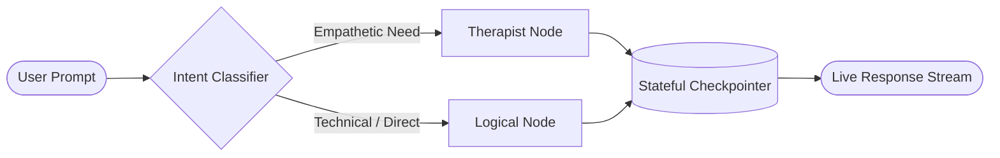

<div align="center">

# Mohammed AL-Haj
### 🤖 AI Engineer | LLMs, Multi-Agent Systems & Computer Vision

**I architect and deploy resilient, production-grade intelligent systems.**  
Bridging autonomous agent orchestration (LangGraph), computer vision pipelines (YOLOv8 + OCR), and distributed big data engines (PySpark).

<br/>

[](mailto:ai.mohammed.alhaj@gmail.com)
[-76B900?style=for-the-badge&logo=nvidia&logoColor=white)](https://github.com/mohammed-m-alhaj)
[](mailto:ai.mohammed.alhaj@gmail.com)
[](https://linkedin.com/in/mohammed-mohammed-al-haj-341ab7369)
[](https://github.com/mohammed-m-alhaj?tab=followers)

<br/>

[🚀 Flagship Projects](#-flagship-production-systems) •
[🏛️ Core Arsenal](#%EF%B8%8F-technical-arsenal--architecture) •
[💼 Why Hire Me?](#-what-i-bring-to-engineering-teams) •
[📬 Get in Touch](#-direct-contact)

</div>

---

## 💡 Executive Summary

I am an **AI Engineer** with hands-on experience building end-to-end AI applications and resilient distributed backends. Rather than relying on simple wrappers or isolated notebooks, I focus on **scalable, fault-tolerant production systems**:

- 🧠 **Agentic AI & LLMs**: Designing deterministic and autonomous multi-agent stategraphs with **LangGraph**, **LangChain**, and **Advanced RAG**.
- 👁️ **Computer Vision & OCR**: Multi-stage deep learning pipelines using **YOLOv8**, **OpenCV**, and **EasyOCR** for complex unconstrained text extraction.
- ⚙️ **Data Engineering & Scaling**: Distributed ETL architectures in **Apache Spark (PySpark)** and **MongoDB** handling tens of thousands of rows/sec with zero data loss.
- 📱 **Full-Stack Client Delivery**: Offline-first mobile products in **Flutter** with background synchronization and local AI fallbacks.

---

## 🚀 Flagship Production Systems

### 1. [TaskFlow — Smart Offline-First AI Productivity Suite](https://github.com/mohammed-m-alhaj/taskflow)
> **A complete, enterprise-grade task management system with native Arabic RTL, zero-latency offline SQLite storage, and Google Gemini AI integration.**

[](https://github.com/mohammed-m-alhaj/taskflow)
[](https://github.com/mohammed-m-alhaj/taskflow)
[](https://github.com/mohammed-m-alhaj/taskflow)
[](https://github.com/mohammed-m-alhaj/taskflow)
[](https://github.com/mohammed-m-alhaj/taskflow)

* **The Problem**: Cloud-only productivity tools crash on unstable networks; typical toy apps lack scalable backends.
* **The Architecture**: Dual-engine design. Offline actions execute locally in **SQLite (`sqflite`)** with zero UI latency. Background **Dio interceptors** synchronize bidirectionally with an asynchronous **FastAPI + PostgreSQL** backend.
* **AI Capability**: Decomposes natural language goals into scheduled checklists using **Google Gemini AI**, with an embedded rule-based offline NLP matcher when disconnected.
* **[📱 Pre-built APK Available for Download](https://github.com/mohammed-m-alhaj/taskflow#--download-apk-android)**

```
[Flutter Mobile App] ──(Offline Cache)──► [Local SQLite Engine]
          │
     (Sync Interceptor)
          ▼
[FastAPI Async Server] ──► [PostgreSQL 15] ──► [Google Gemini AI API]
```

---

### 2. [Enterprise Hybrid Data Migration & Quality Engine](https://github.com/mohammed-m-alhaj/data-migration-pipeline)
> **Production-grade ELT pipeline processing high-volume dirty datasets with automated file routing, 9 deterministic quality rules, and cryptographic SHA-256 idempotency.**

[](https://github.com/mohammed-m-alhaj/data-migration-pipeline)
[](https://github.com/mohammed-m-alhaj/data-migration-pipeline)
[](https://github.com/mohammed-m-alhaj/data-migration-pipeline)
[](https://github.com/mohammed-m-alhaj/data-migration-pipeline)
[-brightgreen?style=flat-square&logo=pytest&logoColor=white)](https://github.com/mohammed-m-alhaj/data-migration-pipeline)

* **The Problem**: Raw migration data contains Eastern Arabic digits (`٠-٩`), colloquial currency strings, and schema drift, causing traditional ETL scripts to crash or drop records silently.
* **The Architecture**: Dynamic router dispatches files $\le 200\text{ MB}$ to a low-overhead Python streaming loader ($O(1)$ RAM), and files $> 200\text{ MB}$ to a **16-partition distributed PySpark cluster**.
* **Zero Data Loss**: Strict mathematical run balance: $\text{Raw} = \text{Valid} + \text{Corrected} + \text{Quarantine}$.
* **Empirical Throughput**: Recorded processing speeds up to **~35,385 rows/sec** on multi-core partitions with automated SHA-256 duplicate elimination.

---

### 3. [Yemen License Plate Recognition System](https://github.com/mohammed-m-alhaj/yemen-licenser-plate-recognition-system)
> **End-to-end multi-stage deep learning pipeline for automated detection, segmentation, and recognition of mixed Arabic/English vehicle plates across 21 governorates.**

[](https://github.com/mohammed-m-alhaj/yemen-licenser-plate-recognition-system)
[](https://github.com/mohammed-m-alhaj/yemen-licenser-plate-recognition-system)
[](https://github.com/mohammed-m-alhaj/yemen-licenser-plate-recognition-system)
[](https://github.com/mohammed-m-alhaj/yemen-licenser-plate-recognition-system)
[](https://github.com/mohammed-m-alhaj/yemen-licenser-plate-recognition-system)

* **The Problem**: Yemeni plates feature heterogeneous typography, dual languages, 5 vehicle classifications, and adverse environmental conditions (dust, harsh glare).
* **The Pipeline**: Multi-stage cascaded inference:
  1. **Vehicle Localization**: YOLOv8 detects vehicle bounds.
  2. **Plate Segmentation**: Sub-model crops and deskews the plate region.
  3. **Multilingual OCR**: Custom fine-tuned EasyOCR pipeline extracts numerals and governorate text with character-level confidence scores.
* **Production API**: Containerized Django REST API with real-time video stream support and a React Vite diagnostic dashboard.

---

### 4. [MindRouter Agent — Multi-Agent Intent Routing System](https://github.com/mohammed-m-alhaj/mindRouter-agent)
> **Autonomous multi-agent conversational architecture routing queries dynamically between emotional and logical personas with stateful LangGraph memory.**

[](https://github.com/mohammed-m-alhaj/mindRouter-agent)
[](https://github.com/mohammed-m-alhaj/mindRouter-agent)
[](https://github.com/mohammed-m-alhaj/mindRouter-agent)
[](https://github.com/mohammed-m-alhaj/mindRouter-agent)



---

## 🛠️ Technical Arsenal & Architecture

| Domain | Core Frameworks & Technologies |
|:---|:---|
| **AI, LLMs & Agents** | **LangGraph**, **LangChain**, Advanced RAG (Hybrid Search, BM25 + RRF), Prompt Engineering, Hugging Face Transformers, Ollama, Vector DBs (**Qdrant**, **Milvus**) |
| **Deep Learning & Vision** | **PyTorch (CUDA Accelerated)**, **YOLOv8**, OpenCV, EasyOCR, Scikit-learn, NLP (SpaCy, NLTK) |
| **Backend & Cloud Architecture** | **FastAPI (AsyncIO)**, **Pydantic v2**, Django REST Framework, **Docker**, PostgreSQL 15, MongoDB 8, Redis, WebSockets |
| **Data Engineering & Big Data** | **Apache Spark**, **PySpark**, Idempotent ETL Pipelines, Automated Schema Validation, Data Quality Gates |
| **Client & Mobile** | **Flutter (Dart, Offline-First Architecture)**, React.js, Streamlit, Material 3 RTL |

<br/>

<div align="center">
  
</div>

---

## 💼 What I Bring to Engineering Teams

1. **System-Level Mindset**: I don't build isolated Jupyter notebooks. I write tested, containerized, defensive production code with Pydantic schemas and CI/CD pipelines.
2. **Defensive Engineering**: Every pipeline I build handles dirty real-world data, network drops, and API limits through idempotency, caching, and graceful offline degradation.
3. **Hardware Fluency**: Capable of benchmarking, quantizing, and running models on local GPU hardware (**NVIDIA RTX 5070 Ti, 12GB VRAM, CUDA 13.4**), drastically cutting cloud inference costs.
4. **End-to-End Execution**: From data preprocessing and model fine-tuning to building the REST API and the mobile/web frontend.

---

## 📬 Direct Contact

I am actively open to **Remote AI Engineering roles**, **AI System Architecture consulting**, and **innovative product collaborations**.

- 📧 **Direct Email**: [ai.mohammed.alhaj@gmail.com](mailto:ai.mohammed.alhaj@gmail.com)
- 💼 **LinkedIn Profile**: [linkedin.com/in/mohammed-al-haj](https://linkedin.com/in/mohammed-mohammed-al-haj-341ab7369)
- 🐙 **GitHub**: [@mohammed-m-alhaj](https://github.com/mohammed-m-alhaj)
- 📍 **Location**: Sana'a, Yemen *(Equipped for high-bandwidth remote work worldwide)*

<br/>

<div align="center">
  <sub>⭐ If you find any of my open-source systems useful, please consider starring the repository!</sub>
</div>
